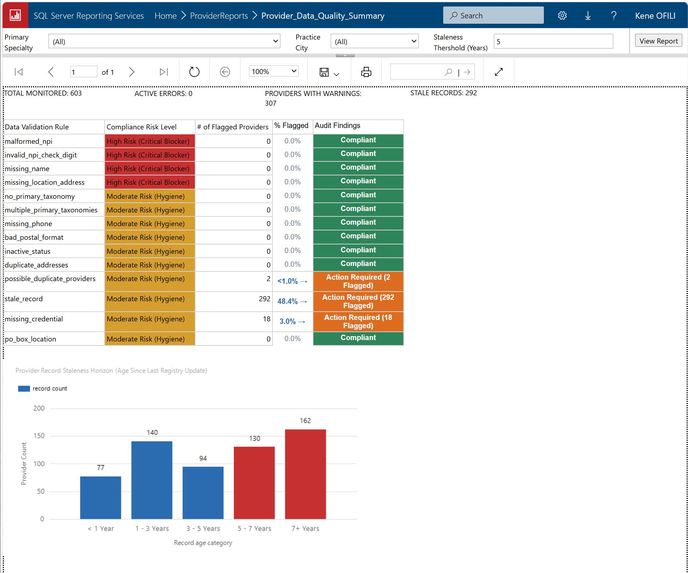

# Healthcare Provider Data Pipeline & Regulatory Governance Suite

An end-to-end healthcare data engineering, in-database quality validation, and business intelligence platform. The suite harvests clinical practitioner records from the federal **CMS National Provider Identifier (NPI) Registry REST API v2.1**, normalizes polymorphic entities into relational schemas across **SQLite** and **Microsoft SQL Server 2025**, evaluates **14 regulatory data-quality rules** via an in-database **ISO/IEC 7812 Luhn Checksum UDF**, and delivers executive dashboards, operational drill-through remediation queues, and automated quality-gated CSV feeds via **SQL Server Reporting Services (SSRS)**.

---

> **At a glance:** 603 Colorado cardiology and dermatology providers ingested from the CMS NPI Registry. 14 validation rules, a Luhn-checksum UDF in T-SQL, and a quality gate that suppresses fatal-error records from vendor extracts. Run it offline in about five minutes with Track A below.



---

## Architecture & Data Flow

```
                                [ CMS NPI Registry REST API v2.1 ]
                                                │
                                                ▼
                                [ Python 3.11 Ingestion CLI ]
                     ├── Chunked Pagination (200 records / batch)
                     ├── Hard Ceiling Monitor (Stops at 1,200 records; flags truncated)
                     ├── Exponential Retry Backoff (HTTP 429 & 5xx with jitter)
                     └── Injected Mock HTTP Opener (Deterministic local test harness)
                                                │
                                                ▼
                                [ Defensive JSON Normalizer ]
                     ├── Coerces polymorphic entities (Individual vs. Organization)
                     ├── Sanitizes string-represented nulls ("--" ──► NULL)
                     └── Standardizes primary taxonomy flags (Boolean / String ──► BIT)
                                                │
                       ┌────────────────────────┴────────────────────────┐
                       ▼                                                 ▼
             [ Phase 1: Local-First ]                         [ Phase 2: Relational Warehouse ]
             SQLite Embedded Database                          Microsoft SQL Server 2025
             (Zero-setup, single-writer)                       (Relational data platform)
             ├── providers (PK: npi)                           ├── dbo.providers (Clustered PK, IX)
             ├── addresses (FK: npi)                           ├── dbo.addresses (Covering IX)
             ├── taxonomies (FK: npi)                          ├── dbo.taxonomies (Covering IX)
             └── provider_export (View)                        └── dbo.provider_export (OUTER APPLY)
                       │                                                 │
                       ▼                                                 ▼
             [ Client Export Engine ]                         [ In-Database Quality Engine ]
             (configs/clients/*.json)                          ├── dbo.fn_npi_is_valid (Luhn UDF)
             └── CSV / JSON Exports                            ├── dbo.vw_quality_rule_failures (14 Rules)
                                                               └── Stored Procedures (Summary, Detail, Extract)
                                                                         │
                                       ┌─────────────────────────────────┴─────────────────────────────────┐
                                       ▼                                                                   ▼
                     [ SSRS Reporting Portal (/ProviderReports) ]                       [ Automated Scheduling & Dispatch ]
                     ├── 1. Provider_Data_Quality_Summary.rdl                            ├── SQL Server Agent (MSSQLSERVER01)
                     │      (KPI Tiles, 14-Rule Matrix, Freshness Histogram)             │   ├── Monthly ETL Ingest (02:00 MT, 1st)
                     │      │                                                            │   └── Monthly Dispatch (06:00 MT, 1st)
                     │      └──► [Interactive Drill-Through Action]                      ├── SSRS File Share Subscription
                     ├── 2. Provider_Data_Quality_Detail.rdl                             └── Windows UNC Share Delivery
                     │      (Actionable Remediation Queue, Dynamic VB Expressions)           └── \\localhost\VendorExports
                     └── 3. Vendor_Extract_Colorado_Cardiology.rdl
                            (Headless Quality-Suppressed Outbound CSV Feed)
```

---

## Strategic Product Narrative & Governance Context

### The Healthcare Directory Problem
Provider directory accuracy is a regulatory and operational priority for health plans and for the providers who supply their data. Under the federal No Surprises Act, health plans must verify provider directory information at least every 90 days, reflect provider-submitted updates within two business days, and remove providers whose information cannot be verified. Providers and facilities share responsibility for submitting accurate updates, and CMS interoperability rules add directory requirements for certain plan types. This project does not measure compliance with those rules. It applies a data-quality lens to a public registry, flagging records that are structurally invalid, incomplete, or old enough to warrant review.

### The Strategic Product Reframe
Traditional data pipelines treat public registries simply as an ingestion task: *"Can we pull records from the API and dump them into our database?"*

This platform was built around a validation-first reframe:
> **"Can we systematically verify which provider records meet schema and credential standards, which carry compliance risks, and which require immediate operational remediation?"**

Under this governance model:
1. **Validation is the primary product.** Ingestion feeds validation; downstream exports and SSRS dashboards deliver verified data.
2. **Quality is multi-tiered.** Structural defects that invalidate billing or identity (malformed NPIs, failed Luhn checksums, missing names) are treated as **Fatal Errors** that trigger automated downstream extraction suppression. Data hygiene defects (stale attestations, missing phone numbers, credential omissions) are treated as **Risk Warnings** routed to dedicated remediation queues.
3. **Architecture scales pragmatically.** The platform was developed first as a local pipeline (Python + SQLite) for rapid prototyping, then migrated to a relational data warehouse (Microsoft SQL Server 2025 + SSRS) with automated agent orchestration, in-engine mathematical validation, and parameterized business intelligence dashboards.

---

## Key Features & Engineering Highlights

* **Resilient API Extraction**: Python-based ingestion client (`src/provider_pipeline/pipeline.py`) with chunked 200-record pagination, exponential retry backoff on HTTP 429/5xx, boundary guarding that respects the federal 1,000-record skip ceiling, and truncation alerting.
* **Defensive JSON Normalization**: Coerces polymorphic entities (individuals vs. organizations), converts string-represented nulls (`"--"`) into true database nulls, and standardizes alternating boolean/string taxonomy flags.
* **Relational Schema with Idempotent Upserts**: Parent `providers` table keyed by 10-digit NPI with child `addresses` and `taxonomies` tables. Upserts on NPI make batch re-runs safe and idempotent, refreshing child rows transactionally.
* **Relational Flattening via T-SQL `OUTER APPLY`**: Foundational export view (`dbo.provider_export`) uses deterministic `OUTER APPLY (SELECT TOP 1 ... ORDER BY id ASC)` subqueries to de-normalize one-to-many child tables into a clean 1:1 provider model, eliminating Cartesian join multiplication.
* **In-Database ISO/IEC 7812 Luhn Checksum UDF**: Scalar function (`dbo.fn_npi_is_valid`) executing the 15-digit Luhn algorithm prefixed with federal constant `80840` directly in the database engine, catching transposed or corrupted identifiers without external network calls.
* **14-Rule Regulatory Quality Validation Engine**: Unified view (`dbo.vw_quality_rule_failures`) evaluating 4 fatal errors (blocking) and 10 hygiene warnings (remediation queues).
* **Summary Dashboard (`Provider_Data_Quality_Summary.rdl`)**:
  * Four KPI scorecards (Total Active Cohort, Critical Errors, Warnings, Stale Records).
  * 14-rule pass/fail matrix with conditional color badges (`PASS` in green, `WARNING` in amber, `FAIL` in red).
  * Interactive drill-through targets with light border accents (`#CBD5E0`), subtle background fill (`#EDF2F7`), bold text, and custom tooltips.
  * Freshness Decay Column Histogram categorizing records into five age tiers (`< 1 Yr`, `1–3 Yrs`, `3–5 Yrs`, `5–7 Yrs`, `7+ Yrs`), highlighting the **48.4% staleness cliff** (292 records).
* **Operational Drill-Through Remediation Queue (`Provider_Data_Quality_Detail.rdl`)**:
  * Actionable provider-level queue linked via cell click actions from the summary dashboard.
  * Context-preserving navigation link (*"← Back to Quality Summary Dashboard"*).
  * Dynamic Visual Basic expressions rendering human-readable staleness descriptions (*"Record updated more than 5 years ago"*).
* **Automated Monthly Vendor Feeds (`Vendor_Extract_Colorado_Cardiology.rdl`)**:
  * CSV extract utilizing wildcard specialty matching (`LIKE '%' + TRIM(@Specialty) + '%'`) to capture composite registry titles (e.g., `Internal Medicine, Cardiovascular Disease`).
  * Automated quality gating that suppresses records failing fatal errors from outbound vendor files.
  * Scheduled distribution via SQL Server Agent and native SSRS Windows File Share subscriptions.
* **Batch Automation & Network Delivery**:
  * Unattended batch orchestration via SQL Server Agent (`MSSQLSERVER01`) on the 1st of each month (02:00 MT ETL ingest, 06:00 MT extract dispatch).
  * Automated delivery to Windows UNC file shares (`\\localhost\VendorExports`).
  * Local-development database connection configured via Microsoft ODBC Driver 18 (`Encrypt=yes; TrustServerCertificate=yes;`).
* **Cross-Database Parity Verification**:
  * Injected mock HTTP opener testing pagination boundaries and backoff without live network calls.
  * Automated cross-database parity audit script (`tests/Reconciliation.sql`) and parity test suite (`tests/test_mssql_parity.py`) verifying 0.000% variance across 603 providers between SQLite and SQL Server 2025.

---

## The 14-Rule Regulatory Quality Waterfall

Every ingested provider record is evaluated against 14 directory checks compiled into `dbo.vw_quality_rule_failures`:

| Rule Name | Severity | Technical Logic & Quality Intent | Status | Flagged Count | % Directory |
|---|---|---|---|---|---|
| `malformed_npi` | `error` | `LEN(npi) <> 10 OR npi LIKE '%[^0-9]%'`. Catches truncated strings, padding, or non-numeric chars. | **PASS** | `0` | `0.0%` |
| `invalid_npi_check_digit` | `error` | `dbo.fn_npi_is_valid(npi) = 0`. Evaluates 15-digit Luhn check digit algorithm prefixed with `80840`. Catches transposed digits. | **PASS** | `0` | `0.0%` |
| `missing_name` | `error` | Asserts Individuals have first/last names and Organizations have `organization_name`. | **PASS** | `0` | `0.0%` |
| `missing_location_address` | `error` | Verifies provider has at least one physical practice address (`purpose = 'LOCATION'`). Telehealth-only or missing clinics cannot receive in-person directory referrals. | **PASS** | `0` | `0.0%` |
| `stale_record` | `warning` | `DATEDIFF(day, last_updated, GETDATE()) > 1825`. Record not updated in 5+ years; project-defined staleness proxy, aligned with directory-accuracy goals. | **WARNING** | **`292`** | **`48.4%`** |
| `missing_credential` | `warning` | Individual practitioner (`entity_type = '1'`) lacks degree credential (MD, DO, NP). Flags records needing credentialing review. | **WARNING** | **`18`** | **`3.0%`** |
| `duplicate_addresses` | `warning` | Exact same physical facility address is registered twice for a single provider. Indicates redundant clinic location entries. | **WARNING** | **`2`** | **`0.3%`** |
| `missing_phone` | `warning` | Practice location address lacks telephone number. Flags missing direct contact channels. | **PASS** | `0` | `0.0%` |
| `bad_postal_format` | `warning` | Postal code fails standard 5-digit (`^[0-9]{5}$`) or 9-digit ZIP+4 (`^[0-9]{5}-?[0-9]{4}$`) validation. | **PASS** | `0` | `0.0%` |
| `po_box_location` | `warning` | Practice street address matches PO Box patterns (`P.O. Box`, `Box [0-9]`). Physical clinical care cannot occur at a PO Box. | **PASS** | `0` | `0.0%` |
| `inactive_status` | `warning` | Provider status marked deactivated (`status <> 'A'`). Prevents deactivated listings in patient portals. | **PASS** | `0` | `0.0%` |
| `no_primary_taxonomy` | `warning` | Zero specialties have `primary_flag = 1`. Causes directory specialty search and referral classification failures. | **PASS** | `0` | `0.0%` |
| `multiple_primary_taxonomies` | `warning` | More than one specialty marked primary. Creates routing ambiguity across clinical specialties. | **PASS** | `0` | `0.0%` |
| `possible_duplicate_providers` | `warning` | Distinct NPIs share identical practitioner name and practice street address. Flags dual enrollments or shared billing identities. | **PASS** | `0` | `0.0%` |
| **Total Reconciled Audit Gate** | — | **Exact Invariant:** 603 Total Providers, 0 Fatal Errors (100% Structural Pass), 312 Total Rule Violations across **307 Unique Flagged Providers**, 296 Clean Records. | **AUDIT CONFIRMED** | **`312`** | **`51.7%`** |

---

## Metric Breakdown: 312 Violations vs. 307 Unique Providers

* **312 Rule Violations:** The 14 checks are evaluated independently. When an individual provider record violates multiple independent checks (such as having an update timestamp older than 5 years and omitting an MD/DO credential), each finding is cataloged separately in `dbo.vw_quality_rule_failures` ($292 + 18 + 2 = 312$).
* **307 Unique Providers:** In operations, a single outreach remediates all findings for a provider at once. Evaluating `COUNT(DISTINCT npi)` across flagged records yields **307 unique providers**. Exactly **5 providers** in the Colorado cohort have dual overlapping infractions:
  * 4 providers: Stale Attestation + Missing Credential
  * 1 provider: Stale Attestation + Duplicate Address Entry

---

## Repository Structure

```text
Provider-Data-Project/
├── README.md                          # Project narrative, architecture & runbook
├── LICENSE                            # MIT License
├── .gitignore                         # Git exclusion rules (DBs, logs, venv, cache)
├── pyproject.toml                     # Python packaging & test dependency configuration
├── searches.json                      # Target regional search criteria (Colorado Cardio & Derm)
│
├── configs/clients/                   # Downstream client export schemas (Phase 1)
│   ├── colorado-cardiology.json       # Filter: Cardiology in Denver, Aurora, Boulder
│   └── example.json                   # General multi-specialty export schema
│
├── docs/                              # Architecture, specifications & case studies
│   ├── product-documentation.md       # Product documentation and schema architecture
│   ├── provider_pipeline_product_documentation.pdf # PDF documentation whitepaper
│   ├── reports-specs.md               # Functional report requirements & monthly SLAs
│   ├── integration-guide.md           # Technical integration runbook & T-SQL mappings
│   └── sample-run.md                  # Baseline live run results and count benchmarks
│
├── fixtures/
│   └── npi-response.json              # Mock API payload for offline testing
│
├── images/
│   └── SSRS_report.jpg                # SSRS Quality Summary Dashboard screenshot
│
├── sql/
│   ├── schema.sql                     # Legacy Phase 1 SQLite schema DDL
│   ├── validations.sql                # Legacy Phase 1 SQLite validation rules (14 checks)
│   └── mssql/                         # T-SQL Database Scripts (Phase 2)
│       ├── 01_schema.sql              # Tables, clustered indexes, and provider_export view
│       ├── 02_npi_luhn.sql            # Scalar Luhn checksum function (dbo.fn_npi_is_valid)
│       ├── 03_quality_rules.sql       # 14 quality validation rules view (dbo.vw_quality_rule_failures)
│       ├── 04_failure_report.sql      # Summary and detail reporting stored procedures
│       └── 05_VendorReportExport.sql  # Substring-matched vendor export stored procedure
│
├── src/provider_pipeline/             # Python ETL Core Engine
│   ├── __init__.py
│   ├── cli.py                         # Command-line interface
│   ├── pipeline.py                    # Ingestion client, JSON normalizer, and SQLite loader
│   └── mssql_loader.py                # Direct pyodbc loader for Microsoft SQL Server 2025
│
├── tests/                             # Automated Test Suites & Reconciliation
│   ├── Checks.sql                     # Ad-hoc T-SQL validation queries
│   ├── Reconciliation.sql             # Cross-database parity audit script
│   ├── test_mssql_parity.py           # Pytest suite verifying 603-provider reconciliation
│   └── test_pipeline.py               # Unit tests for ingestion, pagination & SQLite logic
│
└── ProviderReports/                   # SSRS Visual Studio Project (ProviderReports.slnx)
    ├── dsProviderData.rds             # Shared Data Source (localhost\MSSQLSERVER01)
    ├── Provider_Data_Quality_Summary.rdl  # Summary dashboard & freshness decay histogram
    ├── Provider_Data_Quality_Detail.rdl   # Interactive drill-through remediation queue
    └── Vendor_Extract_Colorado_Cardiology.rdl # Quality-gated automated CSV export feed
```

---

## Quickstart & Execution Runbook

### Prerequisites
* **Python 3.11+**
* **Microsoft SQL Server 2022/2025 Developer Edition** (Instance: `localhost\MSSQLSERVER01`)
* **SQL Server Management Studio (SSMS 20+)**
* **SQL Server Reporting Services (SSRS 2022)**
* **Visual Studio 2022** with SQL Server Data Tools (SSDT)
* **Microsoft ODBC Driver 18 for SQL Server**

---

### Track A: Local Quickstart (Phase 1 — SQLite)

```bash
# 1. Clone repo and create virtual environment
python3 -m venv .venv && source .venv/bin/activate
pip install -e . pytest

# 2. Initialize SQLite schema
provider-pipeline --database provider_data.db init-db

# 3. Ingest from offline mock fixture
provider-pipeline --database provider_data.db ingest --fixture fixtures/npi-response.json

# 4. Run 14 SQL validation rules
provider-pipeline --database provider_data.db validate

# 5. Profile ingested data
provider-pipeline --database provider_data.db profile

# 6. Generate client export files
provider-pipeline --database provider_data.db export --output-dir exports

# 7. Run unit test suite
pytest tests/test_pipeline.py -v
```

---

### Track B: Relational Warehouse Setup (Phase 2 — Microsoft SQL Server 2025)

#### 1. Deploy SQL Server Database Architecture
Open **SSMS**, connect to `localhost\MSSQLSERVER01` (with *Trust server certificate* enabled for local dev), and execute scripts in `sql/mssql/` in order:
1. `01_schema.sql` (Creates database `ProviderData`, tables, covering indexes, and `dbo.provider_export` view).
2. `02_npi_luhn.sql` (Creates scalar Luhn checksum UDF `dbo.fn_npi_is_valid`).
3. `03_quality_rules.sql` (Creates 14-rule audit view `dbo.vw_quality_rule_failures`).
4. `04_failure_report.sql` (Creates stored procedures `dbo.usp_GetQualitySummary` and `dbo.usp_GetQualityDetails`).
5. `05_VendorReportExport.sql` (Creates stored procedure `dbo.usp_ExportVendorData`).

#### 2. Execute Python Ingestion into SQL Server
Harvest live records across Colorado markets (Denver, Aurora, Boulder) for Cardiovascular Disease and Dermatology:

```bash
# Install pyodbc driver
pip install pyodbc pytest

# Run batch loader (utilizes pyodbc.fast_executemany)
python src/provider_pipeline/mssql_loader.py
```

#### 3. Run Cross-Database Parity Test Suite
Verify that the database ingested the active cohort cleanly and that all stored procedures return expected counts:

```bash
python -m pytest tests/test_mssql_parity.py -v
```

---

### Track C: Deploy SSRS Reports & Configure Automated Subscriptions

1. **Deploy Solution in Visual Studio 2022**:
   * Open `ProviderReports/ProviderReports.slnx`.
   * Set Target Server URL to `http://localhost/ReportServer` and Target Folder to `ProviderReports`.
   * Right-click project -> **Deploy**.
2. **Configure Data Source & Permissions**:
   * Open web portal: `http://localhost/Reports`.
   * Open `Data Sources/dsProviderData` -> **Manage** -> enter Windows stored credentials.
3. **Configure Automated Monthly CSV File Drop**:
   * Create dedicated Windows folder: `C:\EnterpriseData\VendorExports` and share over network as `\\localhost\VendorExports`.
   * Open `ProviderReports/Vendor_Extract_Colorado_Cardiology` -> **Manage** -> **Subscriptions** -> **New Subscription**.
   * Delivery method: **Windows File Share**.
   * Path: `\\localhost\VendorExports`.
   * Render format: **CSV**.
   * Schedule: **Recurring on 1st of every month at 06:00 MT**.
4. **Enable SQL Server Agent**:
   * Open Windows Services (`services.msc`) -> verify `SQL Server Agent (MSSQLSERVER01)` is running with Startup Type **Automatic**.

---

## Baseline Parity & Audit Verification

A live run across 6 regional searches (Cardiovascular Disease and Dermatology in Denver, Aurora, and Boulder, CO) captures **603 unique providers** from the federal registry (reflecting live registry growth from the initial 601 benchmark).

To audit data parity directly in SSMS, execute `tests/Reconciliation.sql`:

```sql
USE ProviderData;
EXEC dbo.usp_GetQualitySummary @Specialty = '(All)', @City = '(All)', @StaleYears = 5;
```

```text
====================================================================================================
BASELINE RECONCILIATION SUMMARY (603 Unique Providers)
====================================================================================================
Total Providers Monitored:       603
Critical Errors:                 0 (100% Pass)
Warnings Flagged:                312 Rule Violations
Unique Providers with Warnings:  307 (5 Dual-Rule Overlaps)
Clean Providers (Zero Findings): 296 (49.1%)
Stale Attestations (5+ Years):   292 (48.4% Directory Staleness Cliff)
Missing Degree Credentials:      18 (3.0%)
Duplicate Address Entries:       2 (0.3%)
Cross-Database Drift:            0.000% Variance (SQLite vs. SQL Server 2025)
====================================================================================================
```

---

## Engineering Incidents: 4 Practical Defects Solved

| Incident & Symptom | Root Cause Analysis | Engineering Solution & Code Pattern | Defect Class Prevented |
|---|---|---|---|
| **Silent Zero-Result Taxonomy Query** | Searching for `"Cardiology"` returned 0 rows with no error. CMS catalogs specialists under composite title `"Internal Medicine, Cardiovascular Disease"`. | Re-engineered queries to use case-insensitive wildcard substring matching: `LIKE '%' + TRIM(@Specialty) + '%'`. Added search profiling CLI telemetry. | Prevents false negative empty rosters where entire clinical specialties are omitted from downstream directory publications. |
| **Infinite 1,200-Record Clamped Pagination Loop** | Paging loop requesting `skip += 200` ran endlessly. CMS API imposes a hard ceiling of `skip = 1000`; requests past that silently clamp to 1,000 rather than erroring. | Implemented explicit pagination boundary monitor. Loop terminates strictly when `skip >= 1000` (1,200 records), tagging the query as `truncated = True`. | Prevents runaway ETL loops, excessive memory consumption, and unhandled data truncation in high-density provider searches. |
| **Cartesian Multiplication in Downstream Export** | Flat client export generated 635 rows for a 601-provider cohort, causing downstream billing systems to double-count physicians with multiple office locations. | Re-architected `dbo.provider_export` using T-SQL `OUTER APPLY (SELECT TOP 1 ... ORDER BY id ASC)` subqueries for primary address and taxonomy. | Guarantees a strict 1:1 physician record model, eliminating duplicate billing claims and distorted network provider counts. |
| **SSRS Circular Parameter Dependency** | Deploying SSRS reports failed with runtime error: `Forward dependencies are not valid. Parameter 'RuleName' depends on items that reference it.` | Decoupled parameter bindings by setting `@RuleName` Available Values to `None` and Default to `(All)`. Evaluated filtering in Tablix row expressions. | Eliminates report rendering deadlocks, ensuring stable interactive drill-through rendering across multi-parameter filter matrices. |

---

## Documentation Index

* **[docs/provider_pipeline_product_documentation.pdf](docs/provider_pipeline_product_documentation.pdf)**: Whitepaper detailing data modeling, audit waterfalls, and validation logic.
* **[docs/reports-specs.md](docs/reports-specs.md)**: Report Requirements Specification detailing stakeholder personas, monthly SLAs, parameter definitions, and remediation workflows.
* **[docs/integration-guide.md](docs/integration-guide.md)**: Technical Integration Guide covering T-SQL type mappings, index design, stored procedure schemas, and environment troubleshooting.
* **[docs/sample-run.md](docs/sample-run.md)**: Sample run log and baseline verification audit.

---

## Limitations & Compliance Notice

* **Self-Attested Registry:** An NPI existing in the federal registry confirms registration but does not guarantee that a physician is currently licensed or in good standing. Directory updates should be paired with state licensing board verification.
* **Exact String Matching on Addresses:** Duplicate address checks evaluate normalized exact strings. Variations such as `"Ste"` vs. `"Suite"` are scheduled for future fuzzy-matching resolution.

---

## License

This project is licensed under the MIT License - see the [LICENSE](LICENSE) file for details.
